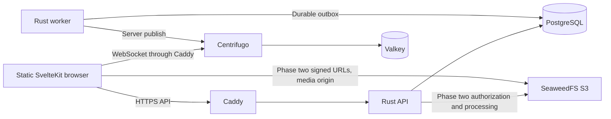

# Telegram-style chat: product and architecture design

Date: 2026-10-12. The user approved this design and inline phase-one implementation.
Phase one is now implemented; its acceptance record is in
[operations](../../operations/phase-1-acceptance.md). This document retains the wider
roadmap. Code ownership after the 2026-10-13 readability refactor is described in
[the architecture guide](../../architecture.md).

## Goals and confirmed constraints

Build a product individuals and small teams can use while exploring Rust, Svelte,
and Centrifugo. Telegram guides features/interactions; protocol compatibility and
implementing every Telegram feature are not requirements.

- Rust backend at the current directory's root; Svelte frontend and tooling in `web/`.
- Centrifugo for realtime delivery; SeaweedFS whenever S3 storage is needed.
- Other libraries/infrastructure are delegated to the developer, using maintained tools.
- Web first, with desktop/mobile browsers and Chinese product UI.
- Self-hosted, invitation-based username/password accounts.
- Cloud-stored messages with multiple-device synchronization and TLS.
- No first-version end-to-end encryption: the server can read stored messages.
- Proposed groups default to 100 members, configurable; this is a product boundary,
  not a measured capacity claim. The working product name is Chat.

Success requires two real browser users finding each other and exchanging messages,
with correct history after disconnects, retries and realtime restarts. Groups/media
require their own actual-infrastructure acceptance when those phases are implemented.

## Architecture choice

| Approach | Benefit | Cost and decision |
| --- | --- | --- |
| Static SvelteKit client, modular Rust monolith, background worker | Unified permissions, static hosting, clear dependencies | Client restores identity; selected for this product |
| SvelteKit SSR/BFF plus Rust | Public rendering and frontend aggregation | Resident Node and another identity boundary; revisit for public/SEO needs |
| Rust microservices and event bus | Independent scaling by subsystem | Distributed consistency/operations; revisit for demonstrated team/scale needs |

One Rust crate builds API, worker, and operator CLI. PostgreSQL supplies the durable
queue. Kafka, RabbitMQ, and Kubernetes are not initial dependencies.

## Stack and reproducibility

This is the selection baseline reviewed on 2026-10-12, not a claim about future latest
versions. Current exact dependencies/images are in manifests, toolchain, and lockfiles.

| Layer | Selection | Responsibility |
| --- | --- | --- |
| UI | Svelte 5, SvelteKit 3 | Runes, routing, static SPA |
| Build/language | TypeScript 6, Vite 8, Node 24, pnpm | Types and reproducible tooling |
| Styling/components | Tailwind CSS 4, Bits UI, Lucide | Controls, accessibility, icons; shadcn-svelte only as needed |
| Server records | TanStack Svelte Query | Authoritative in-memory message/summary cache |
| UI state | Runes and component context | Selection, drafts, optimistic sends, connection state |
| Backend | Rust 1.99, Axum 0.8, Tokio, Tower | HTTP, async execution, middleware |
| Database | SQLx 0.9, PostgreSQL 18 | Transactions, migrations, permanent records |
| Realtime | Centrifugo 6, official centrifuge SDK | Connections and event hints |
| Temporary data | Valkey | Realtime broker/history, rates and presence |
| Objects, phase two | SeaweedFS S3, AWS SDK for Rust | Avatars, images and files |
| Contract | utoipa, openapi-typescript, openapi-fetch | Rust-owned schema and generated typed client |
| Identity | Argon2id, PostgreSQL opaque sessions | Passwords, device expiry and revocation |
| Deployment | Caddy, Docker Compose | HTTPS, static files, API/WebSocket proxy |
| Observability | tracing, Prometheus | Correlation, failures and worker backlog |
| Verification | Rust integration tests, Vitest, Playwright | Invariants and actual browser/infra behavior |

Selection snapshots included Svelte 5.57.2, Kit 3.0.1, SQLx 0.9.0, Centrifugo 6.9.7,
SeaweedFS 4.48, and PostgreSQL 18.6. Toolchain/locks/images are pinned without `latest`.
Kit 3 configuration belongs in `vite.config.ts`, with its current `#lib` conventions.
`adapter-static` supplies SPA fallback; Rust owns business APIs, rather than Kit server
routes or remote functions. Exact implementation decisions are recorded separately.

## Delivery phases

### Phase one: usable private text chat

Invitation registration, login/logout, device listing/revocation; CLI bootstrap,
invite and password reset; Unicode display names and unique exact username lookup;
unique private pairs; summary/history pagination and unread counts; text sending,
saved/failed status and same-ID retry; optimistic sends and device synchronization;
monotonic receipts, expiring typing and relationship-scoped presence; reconnect replay,
duplicate suppression; desktop two-column/mobile one-column navigation, drafts,
keyboard/IME behavior and light/dark/system themes.

Accept the complete account → API → PostgreSQL → outbox → Centrifugo → two-browser
path before introducing groups and media. CLI reset revokes every account session;
passwords use hidden interactive input, never arguments or logs.

### Phase two: groups and SeaweedFS media

Private group creation/title/members/invite/leave/removal; owner/admin/member roles;
the final owner must transfer ownership before leaving; group messages/receipts/unreads;
avatars, image previews, upload progress, download and retry. Default upload cap is
50 MiB; JPEG/PNG/WebP can preview, other types download as files. New members see only
history from their join boundary. Departed/removed members lose history access and
cannot obtain fresh attachment download links.

### Phase three: experience improvements

Replies, editing/deleting one's own messages for everyone, reactions; per-user synced
pin/mute/archive preferences; conversation search and a PWA shell. The implemented
experience batch uses literal PostgreSQL substring matching for Chinese and open-page
notifications; see [its design](2026-10-14-chat-experience.md). Reactions and the PWA
shell remain future work. No initial offline send queue or promise of notifications
after the browser closes. Each batch has its own implementation/acceptance plan.

Later designs may cover channels/large groups, contacts, forwarding/saved messages,
Web Push, audio/video, bot APIs, Tauri, native mobile, and E2EE. Evaluate LiveKit for
calls. Encryption needs its own device/key/history protocol.

## Component and deployment boundaries

Rust owns identity, authorization, commands/history and file permissions. PostgreSQL
owns business truth: records, membership, preferences, sessions and pending jobs.
Worker owns retries/leases, later media processing/cleanup. Centrifugo history is a
temporary cache. Losing Valkey must not lose stored messages; its failure can affect
realtime/rates, and protected writes fail closed when their limiter is unavailable.
SeaweedFS stores bytes while PostgreSQL owns attachment associations and processing.

The main origin proxies `/api/v1` and `/connection/websocket`. Phase-two media uses
a separate origin to isolate uploaded content from the app's identity context.
Database, Valkey, S3 administration and Centrifugo server APIs remain private.

## Durable messages and realtime consistency

1. Browser chooses a UUID `client_message_id`, shows a pending entry and calls Rust.
2. API verifies session, current membership, limits, and later attachment readiness.
3. A transaction locks the conversation, allocates increasing `event_seq`, and writes
   message, persisted event and outbox job. Rollback also rolls back the sequence.
4. Commit returns the authoritative message. Saved means committed, not delivered/read.
5. Worker claims the job, publishes hints, then acknowledges its owned lease.

The sender/conversation/client-ID tuple is unique. Same-ID/same-body retries return
the original record; different-body reuse conflicts. Lost HTTP responses cannot
duplicate storage. UUIDv7 identifies entities; it does not establish synchronization
order. Bigint sequences cross JSON as canonical decimal strings, with BigInt comparisons.

Clients subscribe only to `personal:#<user_id>` with user-limited channels. They cannot
publish directly, enumerate presence, read arbitrary history or subscribe as another user.
Durable hints carry event ID/kind, conversation ID and sequence, without message bodies.
Authorized REST supplies data. Worker fans out to current members; cached hints do not
bypass REST membership. Per-user fanout simplifies device synchronization; measure
large-group costs before designing conversation channels and revocation.

The same-origin WebSocket uses a connect proxy. Centrifugo forwards actual Cookie/Origin
HTTP headers to Rust, which verifies the session and returns database identity with
private session metadata. JSON header claims are ignored. There is no alternative
connection JWT that bypasses session checks. Connect/refresh listeners require an
internal credential and exact allowed origins.

Connections have renewable 60-second leases. Refresh rechecks database session/user
binding. REST revocation is immediate; the same transaction enqueues disconnects for
recorded client IDs. Refresh rejection is a fallback when delivery fails. Measure
refresh grace/disconnect latency; zero cross-process revocation latency is not promised.

Outbox is at least once: a crash after publish and before completion can repeat a hint.
Each aggregate's unfinished predecessor blocks later jobs, while other aggregates
continue. Lease-token/unexpired CAS prevents stale completion. Reclaim expired leases;
retain failed jobs with capped jittered backoff. Partial fanout can resend to successful
recipients. Network exactly-once and late-publication arrival order are not promised.

Every conversation mutation belongs to one persisted sequence, including later edits,
deletions, reactions and membership. Deletions need tombstones so old cache cannot
restore removed text. Clients advance only through applied contiguous events, never
directly to a notification target. Reconnect refreshes summaries and replays
`/conversations/{id}/events?after=...`; available transport history may help, but REST
is authoritative. Reestablish a database snapshot if cache cannot recover.

Subscribe before a message snapshot; preserve notifications received during loading,
then replay after its `snapshot_seq`. Snapshot rows/cursor share repeatable-read isolation.
Epoch/generation fences prevent late responses from crossing session/selection changes.
Refresh summaries every 60 seconds and when returning to the foreground. Recheck
membership and join boundaries for every history/replay request.

Receipts are monotonic per member and converge across devices. Count visible non-own
messages after the receipt rather than subtracting event sequences. Only a focused,
visible rendered timeline and contiguous applied cursor authorize a receipt. A saved
HTTP send ahead of replay must not mark earlier unrendered messages read. Typing is
authorized, rate-limited and expires without durable storage. Presence aggregates live
device connections and is visible only to permitted peers; failure is unavailable,
not an invented offline state.

## Phase-two SeaweedFS object flow

Use AWS SDK custom endpoints with path-style addressing. Object keys do not derive
from untrusted filenames. Browsers receive short-lived signed URLs, never S3 secrets.

1. Validate membership/quota; create attachment record and independent staging key;
   issue signed PUT.
2. Browser uploads directly with progress; retry may request a new URL.
3. Completion uses HEAD and actual format checks; claimed MIME/size are insufficient.
4. Worker copies to a new permanent key and revalidates/processes it. A staging PUT
   must not overwrite a file already referenced by a message.
5. Decode images and bound dimensions; create thumbnails. Only ready attachments can
   be referenced, after ownership/conversation/readiness rechecks.
6. Retry cleanup of expired staging objects; permanent deletion requires no reference
   and the retention policy.

Attachment GET authorization checks current membership and join visibility, then
issues a 60-second signed URL. Avatar visibility is separate from message membership.
Thumbnails may display inline; other files use download responses. Issued URLs can
remain usable until expiry; immediate revocation would require an authenticated proxy.
Internal endpoint serves backend operations, public endpoint signs browser URLs.
Proxy host/path and precise CORS headers must match the signature.

Development may use combined single-process SeaweedFS. A single-node deployment has
no HA; later split master, volume, filer and S3 gateway. Filer has its own metadata
database/credentials; business code does not query internal filer tables. Joint backups
must include business PostgreSQL, filer metadata and volume bytes, with a restore drill.

## Data and API contracts

| Entity | Rule |
| --- | --- |
| users/invitations | Normalized unique username, atomic single use, Argon2id |
| sessions | Hashed token, device label, expiry and revocation |
| conversations | Latest sequence and unique canonical direct pair; groups later |
| members | Role/join/leave/read boundaries, retained historical membership |
| preferences, later | Per-user pin/mute/archive |
| messages | UUID, creation sequence, sender/body; later replies/edit/delete |
| events | Unique conversation sequence and versioned replay payload |
| outbox | Aggregate order, payload, attempts, next attempt, lease and completion |
| attachments, later | Staging/permanent keys, actual size, readiness and associations |
| reactions, later | Unique user/message/reaction tuple |

REST uses `/api/v1`, stable error code/message/request ID and cursor pagination.
Auth, sessions, users, conversations, messages, events, read, typing and later
attachments are public API groups; proxy connect/refresh are private. Rust exports
OpenAPI request/reply/events. TypeScript generates its DTOs, not a second handwritten
contract. Cookie auth is HttpOnly, production Secure, SameSite=Lax and host-only with
explicit expiry. Mutations validate Origin. Session secrets never enter localStorage.
Password work uses a concurrency-bounded blocking pool. Render user input as escaped
text; authorize commands/history/search/references/files at the application boundary.

## Source, operations and verification

Root `Cargo.toml` defines one package, with `src/`, `migrations/`, `tests/`, Rust
Dockerfile and `scripts/`. Frontend package/lock/config/client/tests/Dockerfile stay
in `web/`. Use `pnpm -C web <command>` and root PowerShell checks. Features are cohesive
auth, chat and settings; a function does not need its own crate/module. HTTP → service
→ repository is the current Rust direction; routes/components consume feature state/API.
See the architecture guide for the full current tree and reading paths.

Development Compose supplies four dependencies; host Rust/Vite supply the app.
Production adds API/worker/static frontend/Caddy with injected secrets. Initial machine
inspection found Rust 1.99.0, Node 26.10.0 and Docker 29.8.2. These are historical
inspection results, not prerequisites beyond the pinned tooling policy. Application
build and real-stack verification were subsequently completed for phase one.

Each phase runs relevant format/lint/types/build and actual invariants: concurrent
invite/direct/message retries, nonmember/removed/revoked authorization, crash/reclaim
delivery, disconnect replay, initial-snapshot races, device receipts, real S3 signed
PUT/GET/CORS/completion/cleanup when implemented, and account/message/attachment restore.
Static/mock chat is insufficient. No million-connection claim: measure latency,
connections and backlog before choosing scale changes.

## Official references used for the original selection

- [Svelte releases](https://github.com/sveltejs/svelte/releases)
- [SvelteKit releases](https://github.com/sveltejs/kit/releases)
- [Kit 3 migration](https://svelte.dev/docs/kit/migrating-to-sveltekit-3)
- [Static adapter](https://svelte.dev/docs/kit/adapter-static)
- [shadcn-svelte](https://www.shadcn-svelte.com/docs)
- [Tailwind Vite integration](https://tailwindcss.com/docs/installation/using-vite)
- [TanStack Svelte Query](https://tanstack.com/query/latest/docs/framework/svelte/overview)
- [Axum](https://docs.rs/axum/latest/axum/)
- [SQLx](https://docs.rs/sqlx/latest/sqlx/)
- [PostgreSQL support](https://www.postgresql.org/support/versioning/)
- [Centrifugo releases](https://github.com/centrifugal/centrifugo/releases)
- [Centrifugo engines](https://centrifugal.dev/docs/server/engines)
- [History/recovery](https://centrifugal.dev/docs/server/history_and_recovery)
- [Channel permissions](https://centrifugal.dev/docs/server/channel_permissions)
- [Connect/refresh proxy](https://centrifugal.dev/docs/server/proxy)
- [SeaweedFS S3](https://github.com/seaweedfs/seaweedfs/wiki/Amazon-S3-API)
- [SeaweedFS releases](https://github.com/seaweedfs/seaweedfs/releases/latest)
- [SeaweedFS topology](https://github.com/seaweedfs/seaweedfs/blob/master/note/slides/seaweedfs-production-setup.md)
- [Rust signed URLs](https://docs.aws.amazon.com/sdk-for-rust/latest/dg/presigned-urls.html)
- [Node lifecycle](https://nodejs.org/en/about/previous-releases)
